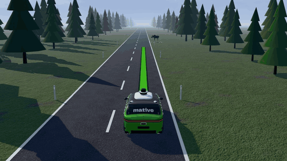
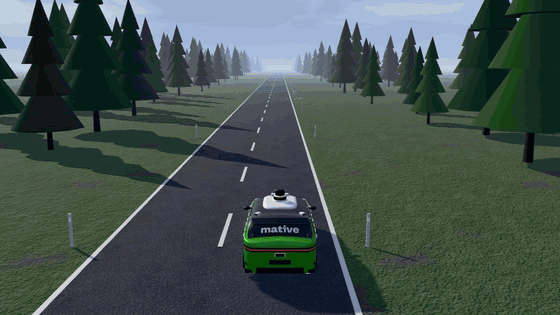
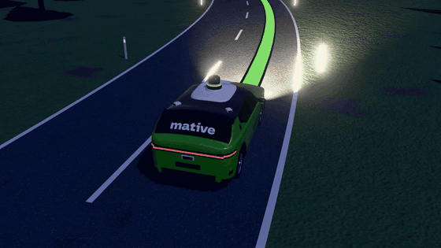

# MPC Autonomous Driving Simulator

[](https://github.com/mative-ai/adss/actions/workflows/verify.yml)
[](LICENSE)
[](CONTRIBUTING.md)
[](https://github.com/mative-ai/adss/labels/good%20first%20issue)

An interactive driving simulation that runs entirely in the browser. A virtual vehicle is driven by a model predictive
controller (MPC) through four emergency scenarios, and its run is shown next to a simpler baseline controller, on the
same road and with the same random seed.

> **Educational simulation, not for homologation.** It shows how a controller reasons in a critical situation. It is not
> a certified or a production system, and the figures it shows describe the simulated vehicle only.

## See it run



| Look around the vehicle                                                                                  | Drive at dusk                                                                                                   |
| -------------------------------------------------------------------------------------------------------- | --------------------------------------------------------------------------------------------------------------- |
|   |  |
| Drag with the mouse to turn the view, use the wheel to move closer, double-click to go back to the road. | The curve with an ice patch, in the dark theme.                                                                 |

The clips are recorded from the simulator, one frame for each 50 ms control cycle, at the speed each scenario is written
for. The sensors drawn on the vehicle are illustration: the simulation works on a list of tracked objects.

## Try it online

A hosted version runs at **<https://adss.mative.ai>**. It opens with an access link: ask for yours on
[Mative's site](https://www.mative.ai/en/mpc-simulator) (also in [Italian](https://www.mative.ai/it/simulatore-mpc) and
[Spanish](https://www.mative.ai/es/simulador-mpc)) and the form takes you to the simulator. Your details stay on
mative.ai: only the access link reaches the simulator, with no personal data. If you would rather share nothing, run it
on your own machine, with open access: see [Getting started](#getting-started).

## The scenarios

| Scenario                | What happens                                                                                           |
| ----------------------- | ------------------------------------------------------------------------------------------------------ |
| Pedestrian crossing     | At 50 km/h on dry asphalt, a pedestrian crosses the road 20 m ahead.                                   |
| Moose test              | At 60 km/h on dry asphalt, a moose leaves the roadside 20 m ahead and stops in the lane.               |
| Curve with an ice patch | At 70 km/h in a left curve, a patch of ice (friction μ 0.1) lies across the bend.                      |
| μ-split braking         | At 80 km/h, the left wheels are on ice and the right ones on dry asphalt. A stopped car is 60 m ahead. |

Each run ends with a report that sets the MPC against the baseline. Every figure in it comes from the run.

The vehicle's top speed can be set from 30 to 130 km/h. Each scenario is written for one speed, and a run at another
shows what that speed leads to.

## How it works

- **The vehicle** has a tire model, actuators and a road with variable friction.
- **The controller** is a real-time-iteration MPC. It plans several candidate maneuvers, checks each on a nonlinear
  rollout and keeps the one with the lowest common cost. Its quadratic-programming solvers are written in TypeScript,
  with no WebAssembly.
- **The baseline** runs in lockstep, with the same seed, so the two runs can be compared sample by sample.
- **The simulation is deterministic.** Time is an integer tick at 1 kHz, randomness comes from seeded generators, and a
  run is rebuilt from the scenario, the seed and the configuration. A timing measured in the browser can slow a run
  down, never change its result.
- **The simulation runs in a Web Worker.** The app only draws and sends commands: it never computes physics or control.
- **The view** is a 3D scene (Three.js) with a mini-map, a top view, and live charts (uPlot). From 1024 px of width the
  scene is realistic, with glTF models that this repository generates (`npm run models`); on a narrower screen, or when
  the GPU cannot keep up, it is a low-poly one.
- **The interface** is in English, Italian and Spanish, in a light or a dark theme. It opens in your browser's language
  when it is one of the three, and in English otherwise; `?lng=it` or `?lng=es` in the address picks one. The theme is the
  system's, unless you pick one with the switch in the top corner.

## Repository

| Path              | What is in it                                                                                   |
| ----------------- | ----------------------------------------------------------------------------------------------- |
| `packages/core`   | The simulation: vehicle, road, world, sensors, MPC, QP solvers, baseline controller, scenarios. |
| `packages/worker` | The Web Worker adapter: the typed protocol, the pacing and the buffer pool.                     |
| `packages/app`    | The web app (React, Tailwind, Three.js, uPlot).                                                 |
| `packages/cli`    | Headless runs in Node: scenario runs, solver benchmarks.                                        |
| `scenarios`       | The scenario definitions (JSON).                                                                |
| `tools`           | The glTF model generator, the package-boundary probes and the deployment checks.                |
| `deploy`          | The nginx configuration of the Docker image; see [deploy/README.md](deploy/README.md).          |

## Getting started

You need Node.js 22.18 or later (24 is what CI uses) and npm.

```sh
npm ci
npm run dev                                       # the development server: opens the simulator
npm run verify                                    # types, lint, format, package boundaries and tests
npm run sim -- --scenario pedestrian --seed 1     # a headless run: prints the result and its fingerprint
npm run build                                     # the production build of the app
```

The scenarios of `npm run sim` are `pedestrian`, `moose`, `ice` and `mu-split`. The same scenario and seed always print
the same fingerprint.

To serve the build, see [deploy/README.md](deploy/README.md): a hardened nginx image, with the response headers and the
Content-Security-Policy in one file.

## Versions

Releases follow [Semantic Versioning](https://semver.org), adapted to a simulator: [VERSIONING.md](VERSIONING.md) says
what counts as a breaking change, and [CHANGELOG.md](CHANGELOG.md) lists what changed. The hosted version runs the
maintainers' own build and may be ahead of the latest release.

## Contributing

Pull requests are welcome. Read [CONTRIBUTING.md](CONTRIBUTING.md) first: it says what is in scope, which rules a change
has to keep, and how to run the checks. Looking for something to work on? [HELP_WANTED.md](HELP_WANTED.md) lists ideas
from a first pull request to a project of several weeks. If you work with an AI coding agent in a console, point it to
[AGENTS.md](AGENTS.md): the commands, the boundaries and the rules, for any tool.

## Community

- **Questions and ideas:** [Discussions](https://github.com/mative-ai/adss/discussions).
- **Bugs and feature requests:** [issues](https://github.com/mative-ai/adss/issues/new/choose),
  with the forms that ask for the scenario, the seed and the version.
- **Something to work on:** [HELP_WANTED.md](HELP_WANTED.md), and the issues labeled `good first issue`.
- **How we behave:** the [code of conduct](CODE_OF_CONDUCT.md). **How to get help:** [SUPPORT.md](SUPPORT.md). **Who decides:**
  [MAINTAINERS.md](MAINTAINERS.md).

## Security

To report a vulnerability, see [SECURITY.md](SECURITY.md).

## License

This project is licensed under the [MIT License](LICENSE). The license text is what governs. In short: you may use,
copy, modify, publish, distribute, sublicense and sell the software, including for commercial purposes, as long as the
copyright notice and the license text stay in every copy or substantial portion of it. The software comes "as is",
without warranty.

**Trademarks.** Mative and the Mative logo are trademarks of Mative Srl, and the license does not grant any right to
them.

## Acknowledgements

The simulator stands on [three.js](https://threejs.org), [React](https://react.dev),
[uPlot](https://github.com/leeoniya/uPlot), the Poppins typeface and QuadProg++ by Luca Di Gaspero, whose structure the
quadratic-programming solvers follow. The licenses of the libraries in the bundle are written by the build to
`third-party-licenses.txt`, and what no package carries is in
[packages/app/public/third-party-notices.txt](packages/app/public/third-party-notices.txt).
